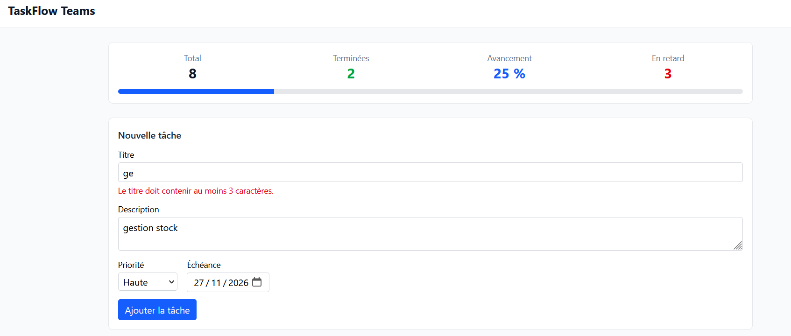
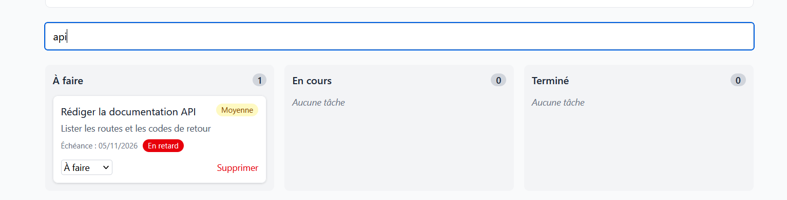

# TaskFlow Teams

Kanban d'équipe en React 19 + TypeScript. Projet fil rouge du module React (DITI4, ISI dakar).

## État d'avancement

- **J1 : maquette statique typée**

## Capture d'écran (J1)


- **J2 : board interactif local**

## Captures d'écran (J2)

### Statistiques et formulaire de création



Le formulaire est contrôlé et validé (titre de 3 caractères minimum, échéance non passée). Les statistiques sont dérivées de la liste des tâches : aucun état dédié.

### Recherche par titre



La recherche ignore la casse. La liste filtrée est calculée à chaque affichage ; les statistiques restent globales.

## Installation

```bash
npm install
npm run dev
```

L'application est alors disponible sur http://localhost:5173.

## Stack

React 19, TypeScript, Vite, Tailwind CSS 4.
