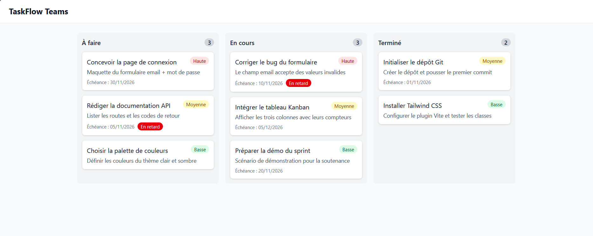

# TaskFlow Teams

Kanban d'équipe en React 19 + TypeScript. Projet fil rouge du module React (DITI4, ISI dakar).

## État d'avancement

- **J1 : maquette statique typée**

## Capture d'écran (J1)



## Installation

```bash
npm install
npm run dev
```

L'application est alors disponible sur http://localhost:5173.

## Stack

React 19, TypeScript, Vite, Tailwind CSS 4.
